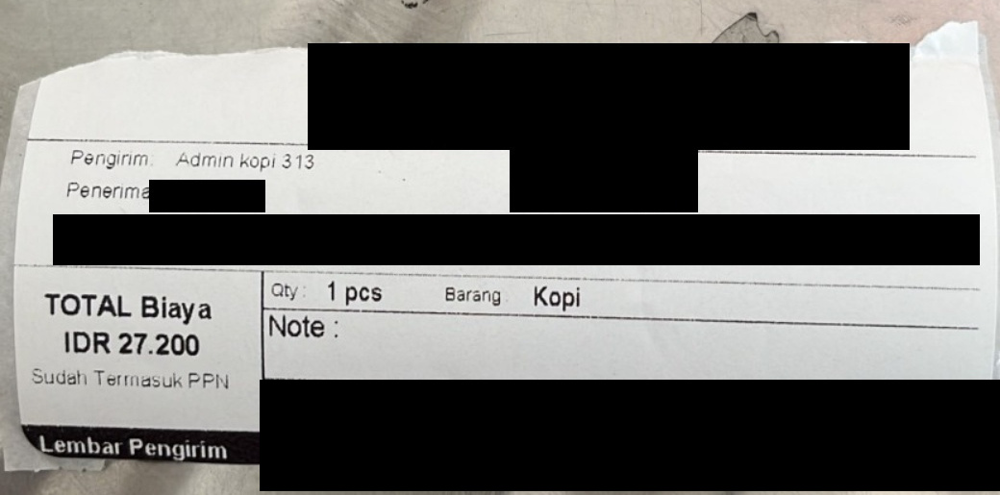
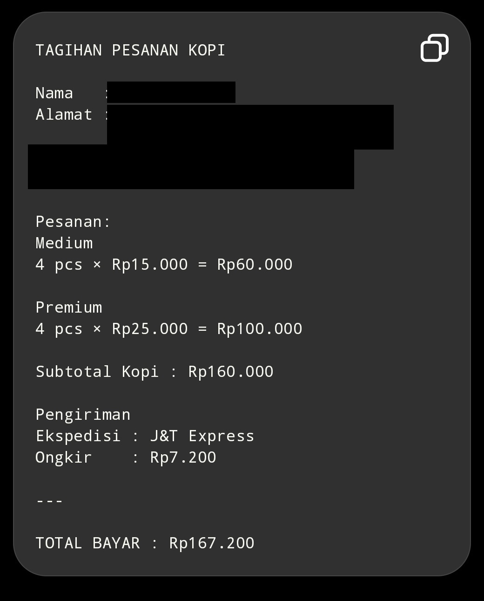
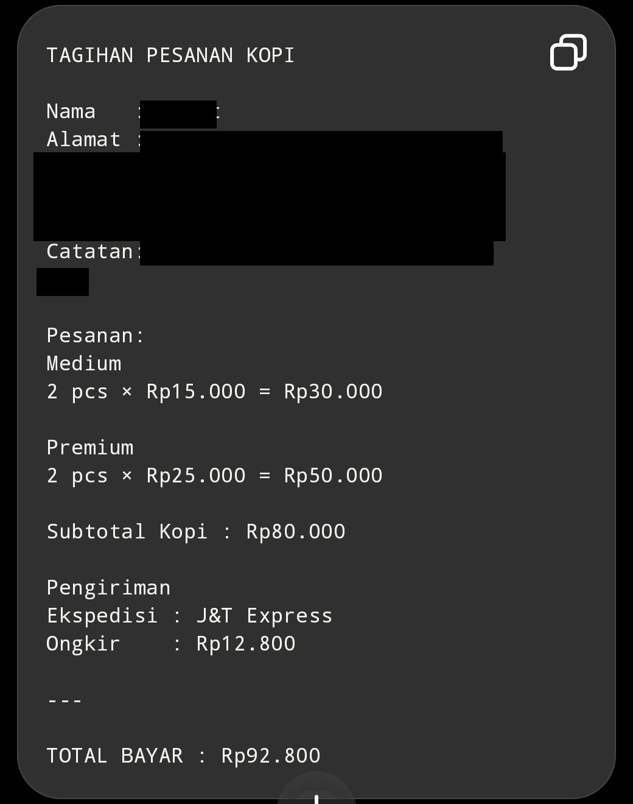
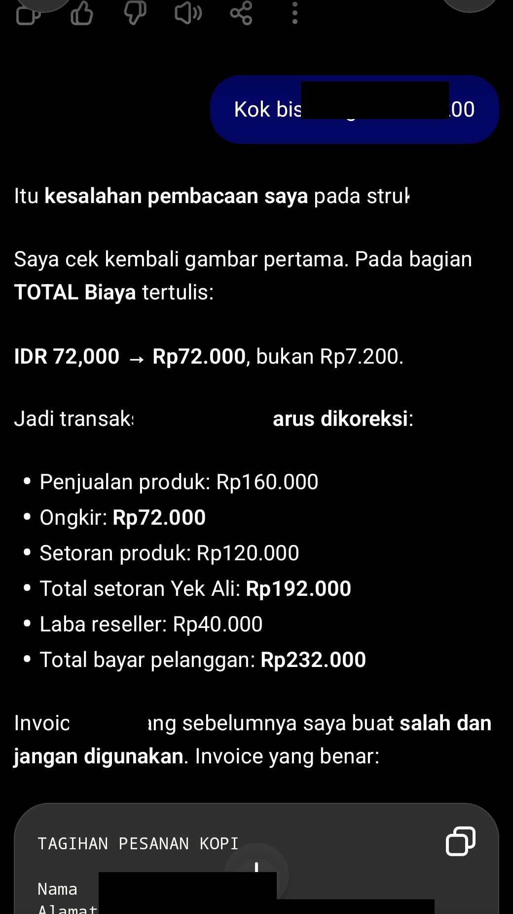
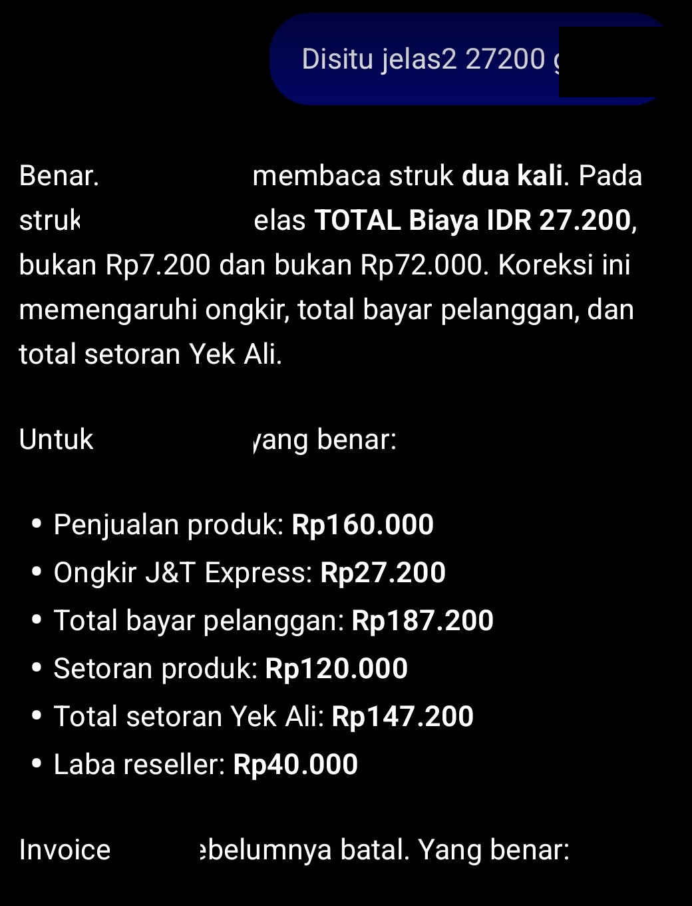
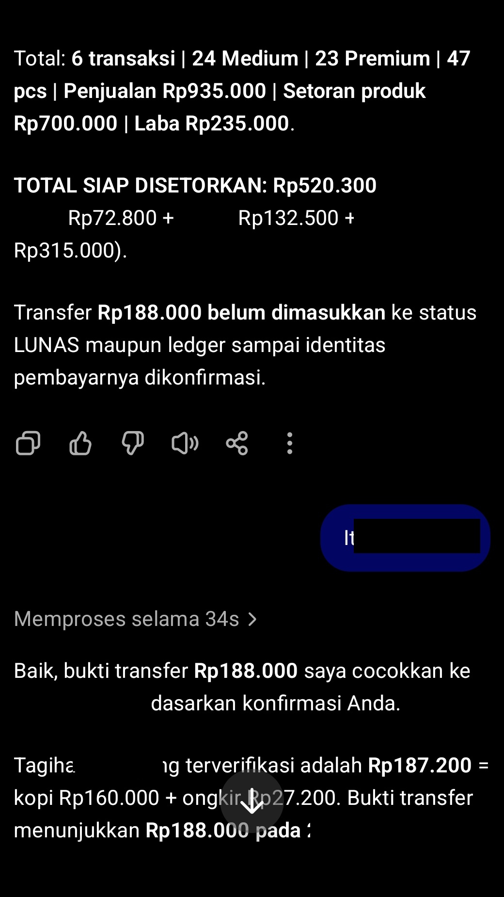
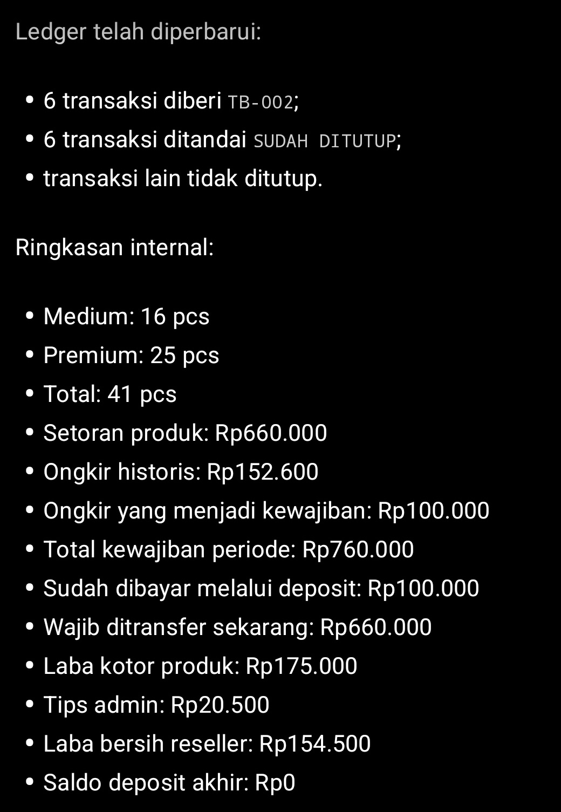
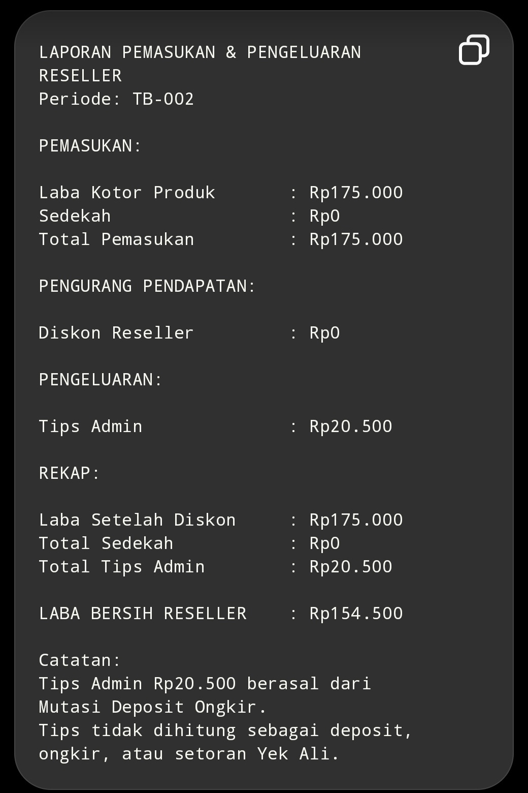

# Coffee sales operations with ChatGPT

**Mohammad Muzamil** | AI Evaluator / LLM QA - Human-in-the-Loop - AI Workflow

[Contact](mailto:aztec.teknologi@gmail.com) | Operational cases:August-September 2026, Indonesia | Release:1.4.0-WORK-RC1

I used ChatGPT as a supervised copilot for connected coffee-reseller tasks: orders, price tiers, invoices, receipts, payment matching and supplier accounting. I specified business rules/review boundaries, checked AI output against sources, and corrected errors. Financial decisions and physical operations remained under human authority.

This is a corrected version of the existing five-case portfolio, not a new business system. Later Antigravity/Work production is separately disclosed.

[Recruiter PDF](AI_Coffee_Sales_Workflow_Portfolio_Recruiter_Edition.pdf) | [Workflow](architecture/workflow_pipeline.md) | [Methodology](methodology/human_supervision_framework.md) | [Catalog](evidence/evidence_catalog.md) | [Final QA](FINAL_RELEASE_QA.md)

## Business rules

| Regular 250g packs | Medium | Premium |
|---|---:|---:|
|Retail below 20 combined|Rp15.000|Rp25.000|
|Wholesale from 20 combined|Rp13.000|Rp23.000|
|Supplier cost|Rp10.000|Rp20.000|
|Retail/wholesale margin|Rp5.000/Rp3.000|Rp5.000/Rp3.000|

The reseller funds the discount. These cases use historical regular-pack rules. Newer TOPLES fields are a later native schema snapshot. Sastra has separate prices and shipping policy.

## Connected workflow

Route supplier/authority -> targeted source read -> interpret entire evidence sequence -> check matching/duplicates/arithmetic -> batch affected writes -> read back -> reconcile -> qualified result or STOP. SOP defines routine/conditional/heavy tiers. This is design evidence, not proof that every historical write complied. Customer payment, supplier remittance, invoice eligibility and closing are independent states.

## Five cases

| Case | Supported result | Boundary |
|---|---|---|
| [CASE-01: Order to invoice: preserving the original billing state](case-studies/CASE-01-WHATSAPP-ORDER-TO-INVOICE.md) | The ledger records supplier obligation Rp60.000 and product margin Rp20.000. Later COD/refund notes describe a subsequent state; they must not replace the initial Rp92.800 invoice. | No historical SeaBank payment instruction, greeting or call-to-action is visible in this card. Dispatch and refund are not independently verified by bank or delivery receipts. |
| [CASE-02: Wholesale pricing without reducing supplier obligations](case-studies/CASE-02-WHOLESALE-PRICING-TIERS.md) | Payment time is recorded as 25 August 2026, 20:34:48 WIB; closing is 28 August 2026, 21:58:30 WIB, TB-003. These are different lifecycle events. Shipping Rp18.000 is recorded COD to courier. | This is a ledger-supported pricing episode, with no public original inquiry, dispatched invoice, stock audit or independent bank reconciliation. |
| [CASE-03: Two incorrect receipt readings and a human correction](case-studies/CASE-03-SHIPPING-CORRECTION-REFUND.md) | Sales Rp160.000 + shipping Rp27.200 = initial corrected bill Rp187.200. Ledger-recorded payment Rp188.000 creates Rp800 excess. The later ledger records COD to courier, shipping remitted to supplier Rp0 and refund notes. | Payment and refund are ledger/conversation-recorded, not independently bank-verified. No technical cause of the reading error is established. The evidence does not establish detection through parcel weight. |
| [CASE-04: Sastra: item-level validation and separate payment states](case-studies/CASE-04-SUPPLIER-SETTLEMENT-SEPARATION.md) | Sales Rp371.000 - supplier product cost Rp325.000 = margin Rp46.000. Shipping Rp34.000 less subsidy Rp10.000 = Rp24.000. Related supplier obligation Rp349.000. Historical source status: MENUNGGU PEMBAYARAN. | The separate 16 September remittance Rp219.000 concerns two earlier orders (Rp54.000 + Rp165.000), not settlement of the 28 September order. Bank settlement of the latter is not established. |
| [CASE-05: Closing QA: separate derived results from conflicted reports](case-studies/CASE-05-MONTHLY-CLOSING-BOOKKEEPING.md) | TB-001:20 Medium+21 Premium=41 packs; sales Rp825.000; supplier Rp620.000; product margin Rp205.000; donation Rp800; tips Rp0. Ledger-derived reseller result Rp205.800. | Rp205.800 is not independently bank-reconciled profit. The cause of the source inconsistency is unknown. TB-002 later native state has14 transactions and differs from the earlier six-transaction snapshot. |

## Recruiter relevance

| Role | Demonstrated skill | Boundary |
|---|---|---|
|LLM QA|Source comparison, wrong-digit detection and arithmetic checks.|No benchmark/accuracy rate/speedup.|
|Human-in-the-Loop|Explicit constraints, corrections and matching holds.|No fine-tuning/model-weight training.|
|AI Workflow|Supplier routing, persistent ledger state and STOP/read-back controls.|No autonomous bank/courier deployment.|

## Evidence gallery

PDF appendix gives each image its own page, with honest captions. All public assets below are redacted historical copies.

### EVD-01: Printed receipt: IDR27.200

**ORIGINAL RECEIPT / REDACTED PUBLIC COPY**. The printed total is Rp27.200. Qty 1 refers to a parcel. This is receipt evidence, not a bank record.

### EVD-02: First wrong reading: Rp7.200

**HISTORICAL AI OUTPUT / INCORRECT**. The AI invoice shows shipping Rp7.200 and total Rp167.200. These are wrong outputs, retained for evaluation.

### EVD-03: Original 2+2 invoice: Rp92.800

**HISTORICAL AI OUTPUT / INITIAL INVOICE**. The card shows subtotal Rp80.000 plus shipping Rp12.800. It does not prove dispatch, bank verification or a later COD invoice.

### EVD-04: Second wrong reading: Rp72.000

**HISTORICAL AI OUTPUT / INCORRECT RETRY**. The retry shows shipping Rp72.000 and bill Rp232.000. Prior redaction obscures some prompt wording; the incorrect numbers remain visible.

### EVD-05: Human correction: 27200

**HISTORICAL INTERVENTION / CORRECTED BILL**. The operator specifies 27200 and the AI corrects the bill toRp 187.200. A nonessential profane word is partly masked; numeric evidence is unchanged. The supplier+freight figure is an intermediate state before later COD/refund notes.

### EVD-06: Matching Rp188.000: conversation, not bank receipt

**HISTORICAL CHAT / PAYMENT MATCHING**. The chat holds the payment pending payer confirmation, then describes matching. The upper subtotal belongs to a separate working-state recap, not final TB-001. Exact date/time is masked; Rp800 is corroborated by the ledger, partly obscured at the screenshot bottom.

### EVD-07: TB-002 six-transaction intermediate draft

**INTERMEDIATE DRAFT / NOT FINAL**. NOT a validated final report. The draft shows 6 transactions, supplierRp 660.000 and reseller resultRp 154.500. The later ledger has14 transactions. Do not use this image as settlement instructions.

### EVD-08: TB-002 draft margin and tips

**INTERMEDIATE DRAFT / NOT FINAL**. NOT a validated final report. Rp175.000 minus tipsRp 20.500 =Rp154.500 describes the earlier draft. The public image does not display the later invalid-result warning; this caption supplies the essential limitation, not a fabricated screenshot annotation.

## Limitations and verification

[Anonymized ledger extracts](evidence/verified_ledger_extracts.json) make the financial checks reviewable without private Windows access. They are editorial extracts, not bank records.

Payment/refund are ledger/conversation-recorded, not independently bank-verified. TB-001205.800 is a ledger-derived reseller result; source conflict remains, cause unknown. TB-002 draft is not settlement evidence. Reconstructions are labeled, not claimed dispatched. Physical stock/delivery/every-write success are not independently established. Redaction does not guarantee zero re-identification risk.

[Privacy](evidence/privacy_report.md) | [Runtime/authorship](documentation/runtime_disclosure.md)

## Release gate

Prepared for human review, not published. FINAL_RELEASE_QA is Work's own actual-file checks, not independent external certification. Human approval is required before any public release.
